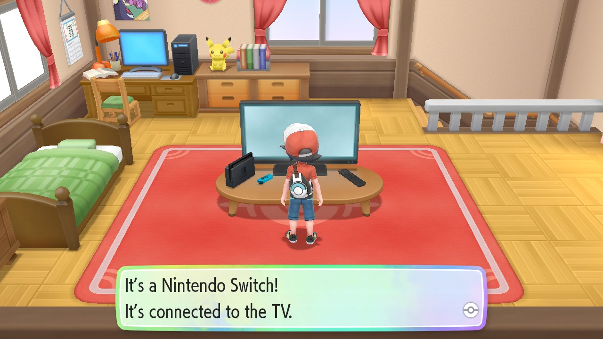
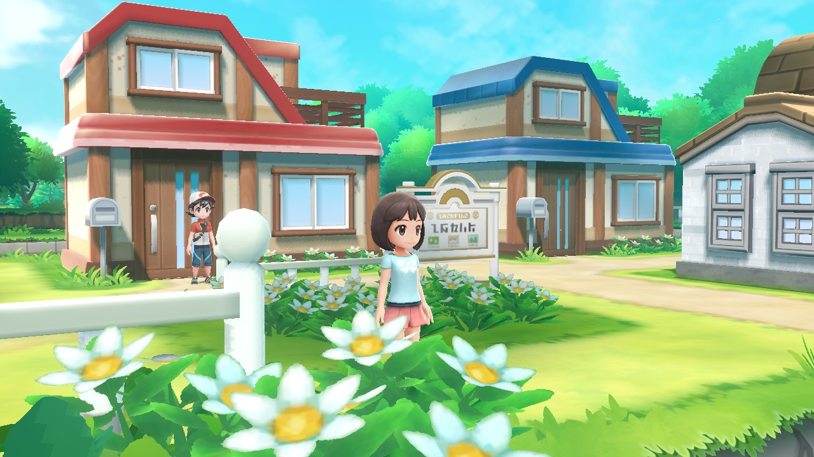
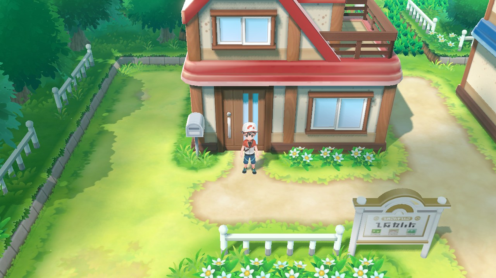
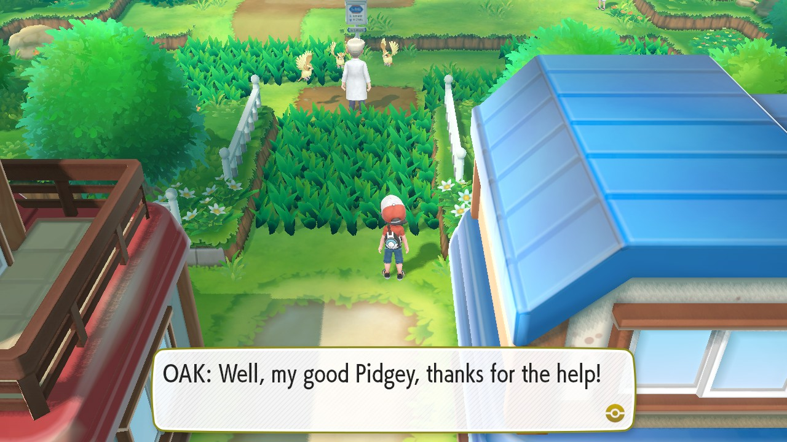
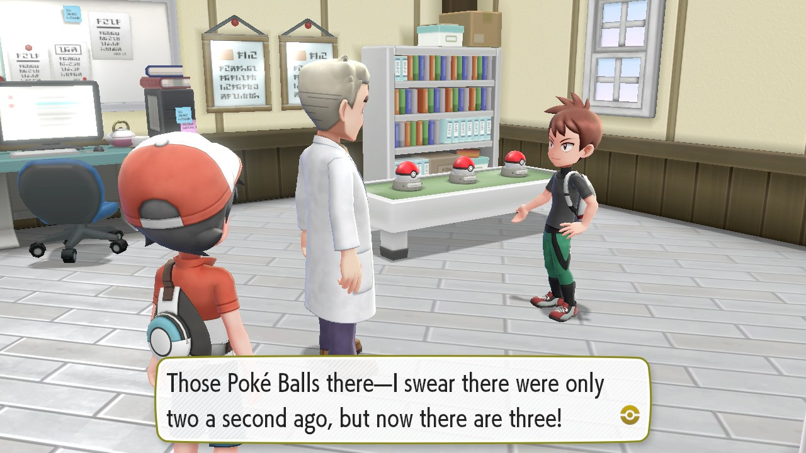
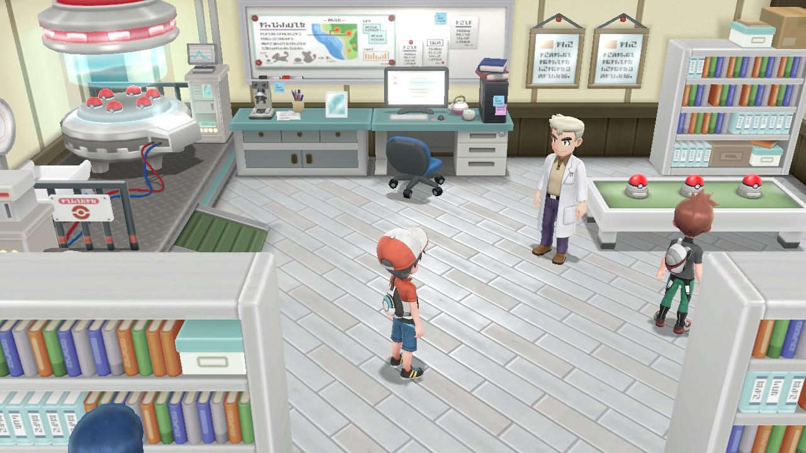

# letsgo-pc

A work in progress native Windows port of **Pokémon: Let's Go, Pikachu!** (v1.0.2). It isn't an
emulator: the game's Switch code is recompiled ahead of time from ARM64 to x86-64
and runs on a PC reimplementation of the Switch SDK, with its own Vulkan renderer,
sound and input. The recompiled code is being replaced with decompiled C++, one
function at a time.

This repository holds the downloads and info about the project. The source code
isn't public (yet).

  
  
  
  
  
  

## Status

Work In Progress (recomp roughly 80% complete, decomp still in early stages)

Works:

- The logos, the intro movie and the professor's introduction
- Naming the player and the rival (a text box opens over the window)
- The bedroom, Pallet Town, Oak's Pikachu event, the catch tutorial and the lab
- Saving and continuing
- Sound, music and movies
- Keyboard and gamepads, with rumble; F11 for fullscreen

Not yet:

- **Motion controls.** A PC has no gyro, so the motion sensors always report at
  rest.
- **Some graphics effects** are missing (effects that use compute shaders, such
  as automatic exposure).
- **Anything online or wireless.** Trading, battling other players, Mystery
  Gifts and Pokémon GO transfers don't work.
- **Let's Go, Eevee!** isn't supported.

## Requirements

- Windows 10 or 11, 64-bit
- A GPU whose driver has Vulkan 1.3 and the `VK_EXT_shader_object` extension.
  Recent NVIDIA drivers have it; for other GPUs, look yours up on
  [gpuinfo.org](https://vulkan.gpuinfo.org/listdevices.php).
- Your own copy of the game, dumped from your own Switch:
  - the base game NSP, v1.0.0 (title ID `010003F003A34000`)
  - the v1.0.2 update NSP (title ID `010003F003A34800`)
  - `prod.keys` from the same Switch

The downloads include none of these, and they won't be shared here. Issues asking
for them will be closed.

## Getting started

Download `letsgo.exe` from the [latest release](https://github.com/pokefan2000XX/letsgo-pc/releases/latest) and follow
that release's notes to point it at your game files.

## Controls

Every keyboard and gamepad drives the Switch's handheld controls. A gamepad's
face buttons follow their printed labels, so the button marked A confirms.
PlayStation pads use the Xbox positions (Cross is A).

| Switch | Keyboard (laid out like DeSmuME and melonDS) | Gamepad |
|---|---|---|
| Left stick (walking, menus) | Arrow keys (hold Left Shift for half tilt) | Left stick |
| A / B / X / Y | X / Z / S / A | Face buttons by label |
| L / R | Q / W | Shoulder buttons |
| ZL / ZR | E / R | Triggers |
| Plus / Minus | Enter / Backspace (or Right Shift) | Start / Back |
| D-pad | I / K / J / L (up, down, left, right) | D-pad |
| Right stick | Numpad 8 4 2 6 | Right stick |
| Stick clicks | F / G | Stick clicks |
| Fullscreen | F11 | |

## Reporting problems

Open an [issue](https://github.com/pokefan2000XX/letsgo-pc/issues) that says what happened and what you were doing,
plus your GPU and driver version. Attach `letsgo.log` from the folder you
started the game in.

## Legal

This project isn't affiliated with or endorsed by Nintendo, Game Freak,
Creatures Inc. or The Pokémon Company. Pokémon and Pokémon: Let's Go, Pikachu!
are trademarks of their respective owners. The downloads contain none of the
game's assets (models, textures, sound, text or movies), so the game won't run
without your own dump.

This project's own work is under the [MIT License](LICENSE). The licenses of
the libraries built into `letsgo.exe` are in
[THIRD_PARTY_NOTICES.txt](THIRD_PARTY_NOTICES.txt).
